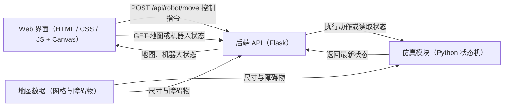

# 项目架构与接口

## 架构图

| 模块 | 实际职责 | 代码目录或入口 |
| --- | --- | --- |
| Web 界面 | 绘制网格地图、边界、障碍物和机器人；提供前进/左转/右转/重置按钮；渲染状态面板并定时同步 | `frontend/index.html`、`style.css`、`app.js` |
| 后端 API | 提供地图、状态查询和控制指令接口；校验指令；开启静态页面托管 | `backend/app.py` |
| 仿真逻辑 | 维护机器人坐标、朝向和状态；处理前进及边界/障碍判定；重置 | `backend/simulation.py` |
| 地图数据 | 定义地图尺寸、障碍物集合、起点和坐标工具函数 | `backend/map_data.py` |

## 数据约定

- 地图坐标原点在**左上角**，x 向右递增，y 向下递增，一个格子为一个单位；地图尺寸为 20 × 15。
- 地图边界由 `width`、`height` 表示，障碍物由坐标数组 `[[x, y], ...]` 表示，例如 `[[5, 3], [5, 4]]`。
- 机器人位置字段 `x`、`y` 为整数格坐标；`direction` 取 `N`/`E`/`S`/`W`（北/东/南/西）；`status` 取 `idle`（待机）、`moving`（移动中）、`blocked`（受阻）。
- 初始状态为 `(1, 1)`，朝向 `E`，状态 `idle`。
- 前端初始化时并行请求 `GET /api/map` 和 `GET /api/robot`；每次控制指令用响应直接更新状态；另外每 2 秒轮询 `GET /api/robot`，保证页面与 API 一致。

## 接口约定

| 用途 | 方法与路径 | 请求参数或请求体示例 | 成功响应示例 | 失败响应示例 |
| --- | --- | --- | --- | --- |
| 获取地图 | `GET /api/map` | 无 | `{"width":20,"height":15,"obstacles":[[5,3],[5,4],[5,5],[10,8],[11,8],[12,8],[14,2],[14,3]]}` | — |
| 获取机器人状态 | `GET /api/robot` | 无 | `{"x":1,"y":1,"direction":"E","status":"idle"}` | — |
| 发送手动控制指令 | `POST /api/robot/move` | `{"command":"forward"}` | `{"x":2,"y":1,"direction":"E","status":"moving"}` | HTTP 400 `{"error":"无效指令，应为 forward, left, right, reset"}` |

`command` 可取 `forward`（前进一格）、`left`（左转）、`right`（右转）、`reset`（回到起点）。前进时若目标越界或撞上障碍物，坐标保持不变，返回 `status: "blocked"`。

可执行的请求命令和预期结果见[后端 README](../backend/README.md)。
